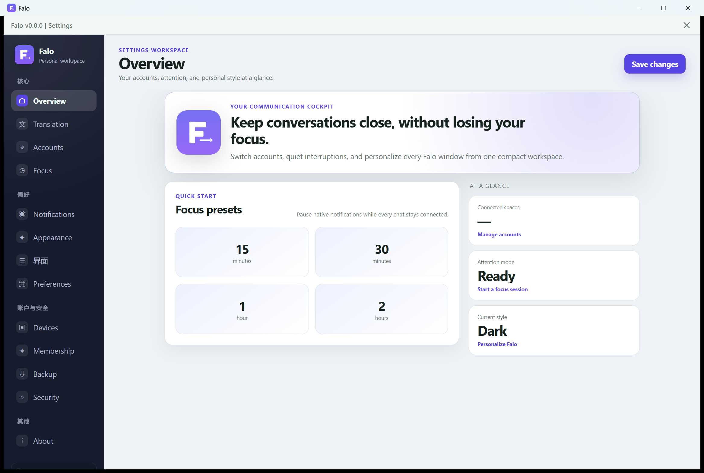

# Falo（飞译）· WhatsApp Web 翻译工作台（开源重建）



> 由 WATransChat 2.6.5（Windows / Tauri 2）发布物重建，**已整体改名换标**：
> 产品名 Falo / 飞译，图标重绘，主色从 WhatsApp 绿换成靛紫，
> 代码里的 `WATransChat` / `WhatsNow` 标识已全部替换为 `Falo` / `falo`。

## 命名

| 项 | 原版 | 本项目 |
|---|---|---|
| 产品名 | WATransChat | **Falo**（中文：飞译） |
| 包名 / 标识符 | `app.whatsnow.desktop` | `app.falo.desktop` |
| Cargo 包 | — | `falo-oss` |
| 全局对象 | `__whatsnow*` | `__falo*` |
| 环境变量 | `WATRANSCHAT_*` | `FALO_*` |
| 主色 | `#087a60` / `#25d366`（绿） | `#4f46e5` / `#6366f1`（靛紫） |
| 图标 | 绿色 W 徽标 | 靛紫渐变 + 白色 F + 箭头（`frontend/app-icon.svg`） |

改名脚本：`tools/rebrand.py`（可重跑；同时做图标与主题色替换）。

## 与原版的差异（不只是换皮）

| 维度 | 原版 | Falo |
|---|---|---|
| 左侧导航 | 13 项平铺，顺序 Overview→Accounts→Focus→Appearance→界面→… | **4 组分区**：核心（Overview/Translation/Accounts/Focus）/ 偏好（Notifications/Appearance/界面/Preferences）/ 账户与安全（Devices/Membership/Backup/Security）/ 其他（About） |
| Overview 排布 | 横幅 → 三列指标 → 快捷预设，竖向堆叠 | **两栏**：左=Focus presets（2×2 大卡）/ 右=At a glance 指标竖排 |
| 横幅卡 | 图标在右 | 图标左置 84px，正文左对齐 |
| 默认窗口 | 1100×720 | **1320×860**，两栏断点 940px |
| 品牌 / 图标 / 主色 | WATransChat、绿色 W、WhatsApp 绿 | Falo、靛紫 F 徽标、靛紫主题 |

> 已知：整个 UI 骨架、文案、i18n 仍来自原版发布物（提取所得）；上表是已经做过的**结构性**改动，
> 不是只改颜色。要继续拉开差距，可以在交互层（默认落地页、面板信息架构）上再做一轮。

## 恢复了什么

| 部分 | 状态 | 位置 | 体积 |
|---|---|---|---|
| WhatsApp 页面注入脚本（翻译 / i18n / AI 建议 / 汇率 / 设备徽标 / 发送钩子 / 语音） | ✅ 明文源码 | `content-scripts/` | 1698 KB（整包 1.03 MB + 21 个命名模块） |
| Tauri 命令面（前端 `invoke()` 的名字） | ✅ 名单 | `docs/tauri-commands.md` | — |
| 远端接口域名与路径 | ✅ 字符串级 | `docs/endpoints.md` | — |
| Rust 后端 | ✅ **74 条命令、约 4.4k 行，cargo check / build 全绿、0 warning** | `backend/` | 135 KB |
| UI 前端（index.html / main.js / style.css / login / tabs / lock / i18n / vendor xlsx / 图标） | ✅ **26 个文件 2.78 MB**，brotli 流逐条解出 | `frontend/` | 2.78 MB |
| 远端服务（会员 / 翻译 / 计费） | ❌ 服务端，不在客户端 | 只能按 `docs/endpoints.md` 复刻协议 | — |

## 目录

```
content-scripts/
  falo-content-bundle.js   注入脚本整包（明文，带原注释）
  modules/                    按注释切出的模块（便于阅读）
docs/
  tauri-commands.md           命令面
  endpoints.md                网络端点
backend/                      Tauri 2 (Rust) 重建骨架：Cargo.toml / tauri.conf.json / src
frontend/                     占位页 + 资源恢复说明
tools/                        资产切分 / 内存扫描脚本（继续挖用）
```

## 已经跑起来了

`cargo build` 出的 `backend\target\debug\falo-oss.exe` 能启动并渲染出**恢复出来的原版设置界面**
（Overview / Accounts / Focus / Appearance / Notifications / Preferences / Membership / Translation /
Devices / Backup / Security / About 全在）：


构建方式（GNU 工具链，不需要装 3GB 的 VS Build Tools）：

```powershell
winget install -e --id BrechtSanders.WinLibs.POSIX.UCRT
rustup toolchain install stable-x86_64-pc-windows-gnu --profile minimal
$env:PATH = "$env:USERPROFILE\.cargo\bin;<winlibs>\mingw64\bin;$env:PATH"
cd backend && cargo +stable-x86_64-pc-windows-gnu build
```

## 骨架说明

```bash
cd backend && cargo build     # 需要 Rust + WebView2
```

前端资源补齐后：`cargo tauri dev`。

## UI 是怎么解出来的

`.rdata` 里每条资源 = **明文路径 + brotli 流**。坑在于：

- `brotli.decompress(整段缓冲区)` 会因尾随字节报 `decoder failed` → 必须按记录边界切长度；
- 路径末字节可能吞掉流首字节（`/main.js[` 的 `[` = `0x5B`）→ 起点要在 ±2 字节里试。

`tools/extract_by_anchor.py` 做前者，`tools/pass3.py` 补齐 PNG 与无锚点流（`index.html` 就在尾段）。

## 授权

重建部分（骨架、文档、工具）按 MIT 发布，见 `LICENSE`。
`content-scripts/` 内容来自发布物的可读片段，用于互操作与研究；商用或再分发请自行确认权利。
